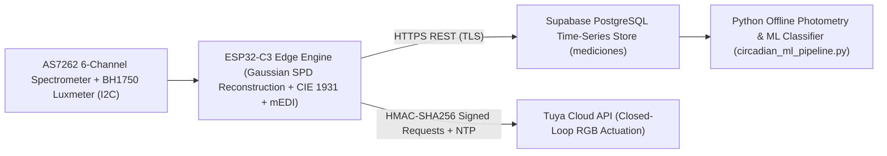

# Light-Well — Embedded Photometry, Circadian Spectral Intelligence & Closed-Loop Actuation

End-to-end embedded photometry and circadian lighting control system built on an **ESP32-C3**, an **AS7262** 6-channel multispectral sensor, a **BH1750** digital lux meter, **Supabase** time-series telemetry, **Python** spectral regime classification, and **Tuya Cloud** authenticated HMAC-SHA256 actuation.

---

## System Architecture



---

## Photometric & Spectral Reconstruction Formulation

The firmware and offline Python analytics engine reconstruct the continuous visible Spectral Power Distribution $S(\lambda)$ over $\lambda \in [400, 700]\text{ nm}$ ($\Delta\lambda = 1\text{ nm}$) using Gaussian basis modeling across the six calibrated `AS7262` channels ($450, 500, 550, 570, 600, 650\text{ nm}$ with channel gains $a_n = [1.24, 4.30, 0.95, 0.95, 0.415, 1.20]$ and $\sigma_{\text{violet}} = 11.05\text{ nm}$, $\sigma_{\text{default}} = 17.0\text{ nm}$) augmented with two interpolated intermediate bands at $525\text{ nm}$ and $626\text{ nm}$:

$$S(\lambda) = \sum_{i=1}^{6} \frac{M_i a_i}{\sigma_i\sqrt{2\pi}} \exp\left(-\frac{(\lambda - \lambda_i)^2}{2\sigma_i^2}\right) + \sum_{k=1}^{2} \frac{M_k^{\text{ext}} a_k^{\text{ext}}}{\sigma_k\sqrt{2\pi}} \exp\left(-\frac{(\lambda - \lambda_k^{\text{ext}})^2}{2\sigma_k^2}\right)$$

1. **CIE 1931 $2^\circ$ Chromaticity Integration:** Numeric integration against the standard observer color-matching functions $(\bar{x}(\lambda), \bar{y}(\lambda), \bar{z}(\lambda))$ yields tristimulus $(X, Y, Z)$ and normalized chromaticity coordinates $(x, y)$.
2. **Correlated Color Temperature (McCamy Approximation):**
   $$n = \frac{x - 0.3320}{y - 0.1858}, \qquad \text{CCT}(n) = -449n^3 + 3525n^2 - 6823.3n + 5520.33 \in [2000, 10000]\text{ K}$$
3. **CIE S 026 Melanopic Equivalent Daylight Illuminance ($\text{mEDI}$):**
   $$\text{mEDI} = E_{\text{lux}} \cdot \left(4.324\times 10^{-12}\text{CCT}^3 - 8.325\times 10^{-8}\text{CCT}^2 + 6.147\times 10^{-4}\text{CCT} - 0.750\right)$$

---

## Experimental Dataset & ML Classification Benchmark

The dataset in `hardware/python/data/mediciones.csv` contains **159 multi-channel optical measurements** across **8 discrete spectral operating regimes** (`label` 1–8). Evaluating standardized normalized spectral and photometric features (`hardware/python/circadian_ml_pipeline.py`) with 5-fold stratified cross-validation yields:

* **Nearest-Centroid Classifier (5-fold CV):** `100.0%` (`159 / 159`)
* **3-Nearest Neighbors Classifier (5-fold CV):** `100.0%` (`159 / 159`)

| Regime | Samples | Mean Lux | Mean CIE $(x, y)$ | Mean CCT (K) | Mean mEDI | Closed-Loop Rule State |
| :--- | :---: | :---: | :---: | :---: | :---: | :--- |
| **1** | 19 | 359.65 | (0.4453, 0.3899) | 2741.2 | 143.33 | `OFF` (High ambient melanopic flux) |
| **2** | 20 | 363.04 | (0.4263, 0.3756) | 2945.5 | 162.94 | `OFF` |
| **3** | 20 | 361.04 | (0.3928, 0.3471) | 3425.2 | 199.49 | `OFF` |
| **4** | 20 | 362.71 | (0.3749, 0.3337) | 3828.1 | 226.96 | `OFF` |
| **5** | 20 | 360.83 | (0.3575, 0.3208) | 4353.4 | 254.40 | `OFF` |
| **6** | 20 | 359.83 | (0.3411, 0.3060) | 5025.0 | 282.61 | `OFF` |
| **7** | 20 | 370.50 | (0.3233, 0.2928) | 6099.9 | 327.30 | `OFF` |
| **8** | 20 | 381.59 | (0.3128, 0.2850) | 6975.2 | 364.29 | `OFF` |

For twilight/low-mEDI circadian actuation, the firmware transitions between `LOW_STIMULATION_PINK` ($0 \le \text{mEDI} < 10$, Tuya HSV `h=330, s=1000, v=1000`) and `HIGH_STIMULATION_RED` ($10 \le \text{mEDI} < 20$, Tuya HSV `h=0, s=1000, v=1000`).

---

## Hardware Prototype


* **SoC:** `ESP32-C3 Mini` (Wi-Fi STA, TLS HTTPClient, `mbedtls` SHA-256 / HMAC-SHA256)
* **Spectral Sensor:** `AS7262` 6-channel calibrated visible spectrometer (`I2C`)
* **Lux Sensor:** `BH1750` digital ambient light sensor (`I2C`, continuous high-res mode)
* **Actuator:** Tuya Cloud compatible RGB luminaire (`colour_data_v2` / `colour_data` DP fallback)

---

## Security & Configuration

All Wi-Fi, Supabase, and Tuya Cloud credentials are decoupled from tracked source code:

1. Copy `hardware/secrets.example.h` to `hardware/secrets.h` (which is ignored by Git via `**/secrets.h`).
2. Populate your `SECRET_WIFI_SSID`, `SECRET_WIFI_PASS`, `SECRET_SUPABASE_URL`, `SECRET_SUPABASE_ANON_KEY`, `SECRET_TUYA_ACCESS_ID`, `SECRET_TUYA_ACCESS_SECRET`, and `SECRET_TUYA_DEVICE_ID`.
3. Compile and flash `hardware/Light well.ino`.

---

## Repository Structure & Verification

```text
light-well/
├── hardware/
│   ├── Light well.ino                     # ESP32-C3 firmware (photometry + Supabase + Tuya HMAC-SHA256)
│   ├── secrets.example.h                  # Template header for local credentials
│   ├── arduino_sensor_data_acquisition/   # PlatformIO raw CSV data-acquisition project
│   └── python/
│       ├── circadian_ml_pipeline.py       # Offline SPD/CIE1931/mEDI engine + stratified CV classifier
│       ├── log_spectro_bh1750.py          # Serial CSV logger
│       └── data/
│           ├── mediciones.csv             # 159-sample labeled multispectral dataset
│           └── photometric_summary.json   # Recomputed photometry & CV benchmark summary
└── tests/
    └── test_photometry_ml.py              # Automated unit tests for photometry physics and ML CV
```

Run the offline photometry pipeline and automated test suite:

```bash
python hardware/python/circadian_ml_pipeline.py
python -m unittest discover -s tests -v
```

---

## License

MIT License. See [LICENSE](LICENSE).
